  

I'm Mathis, a developer in Choisy-le-Roi, just outside Paris. I build websites and mobile apps, and since October 2026 I do it as a freelancer.

The banner is the idea behind [my portfolio](https://mathisboulais.com): one idea goes in, projects come out. Each ray has its card below.

 

  
  

  
  

  
  

 

### What I write in

  

TypeScript every day, React and React Native for most projects, Rust and Svelte when it's a desktop app.

  

Where I started: C#, C++ and Java, then PHP with Symfony and Python with Django.

 

### Contact

Got a project? Write to me, I reply within 24 hours.

[contact@mathisboulais.com](mailto:contact@mathisboulais.com) · [LinkedIn](https://www.linkedin.com/in/mathis-boulais-0974a0213) · [mathisboulais.com](https://mathisboulais.com)
